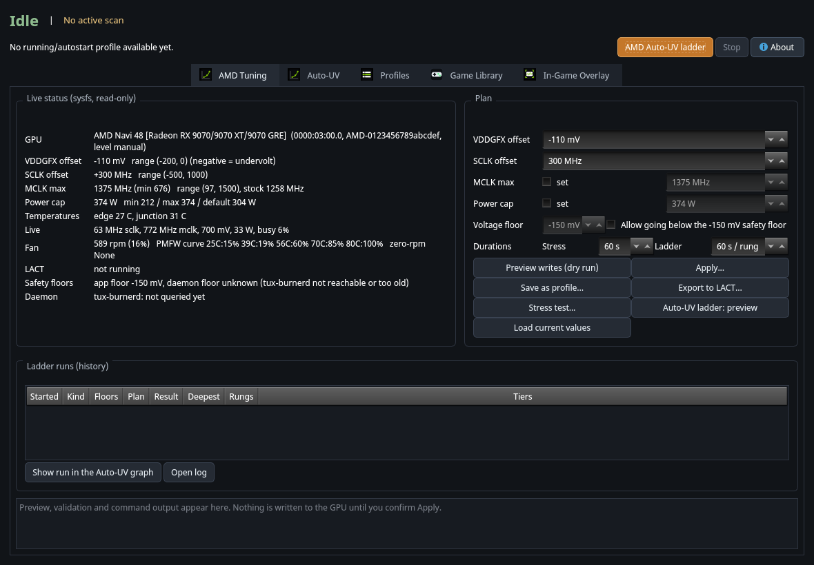
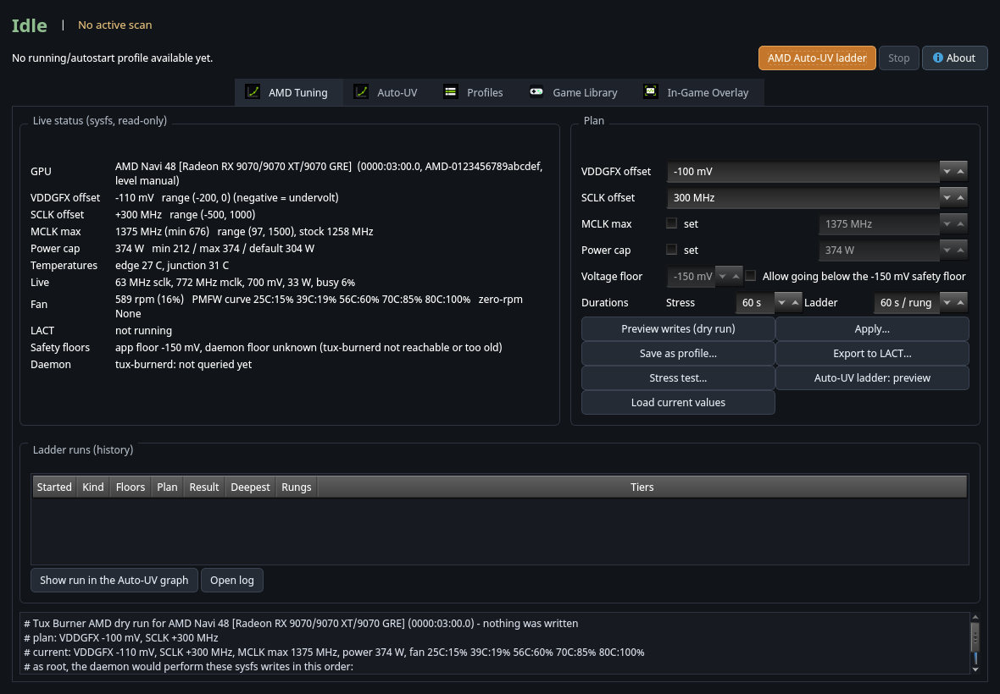
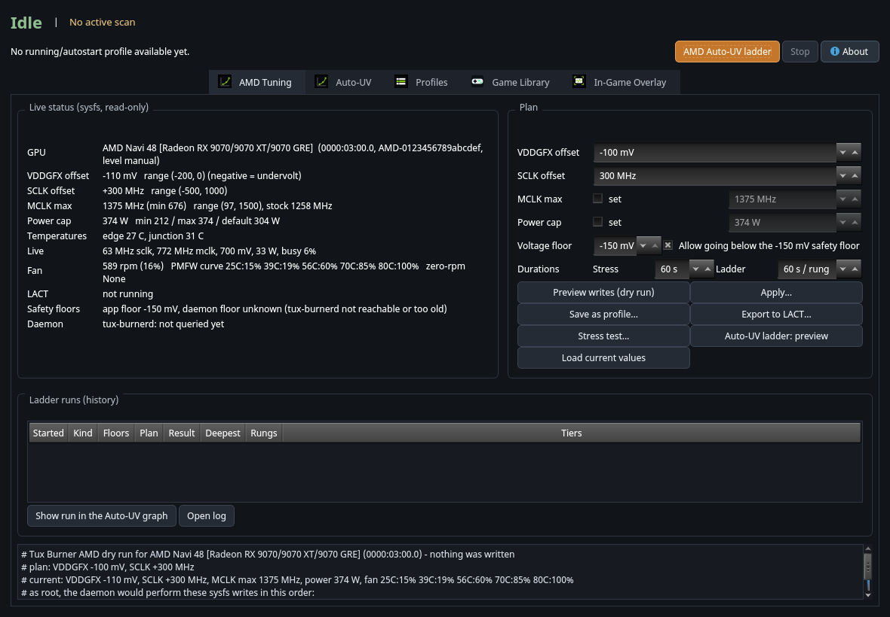
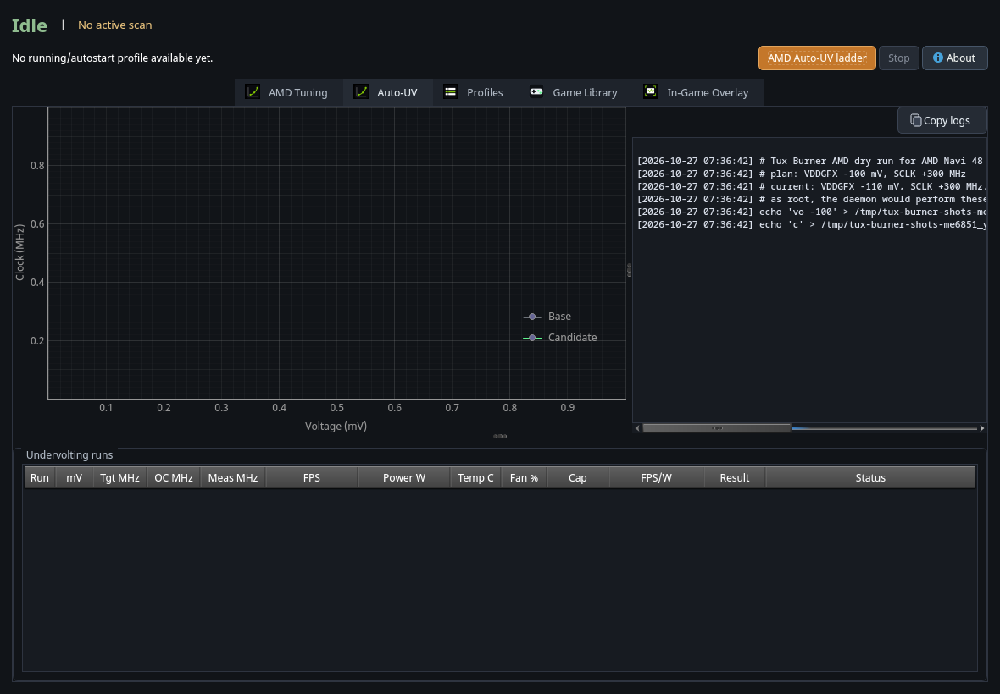
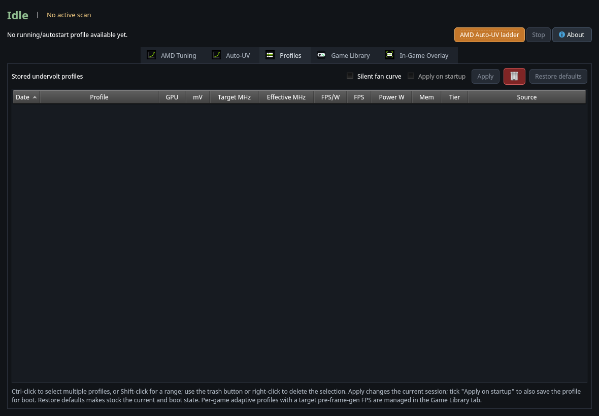
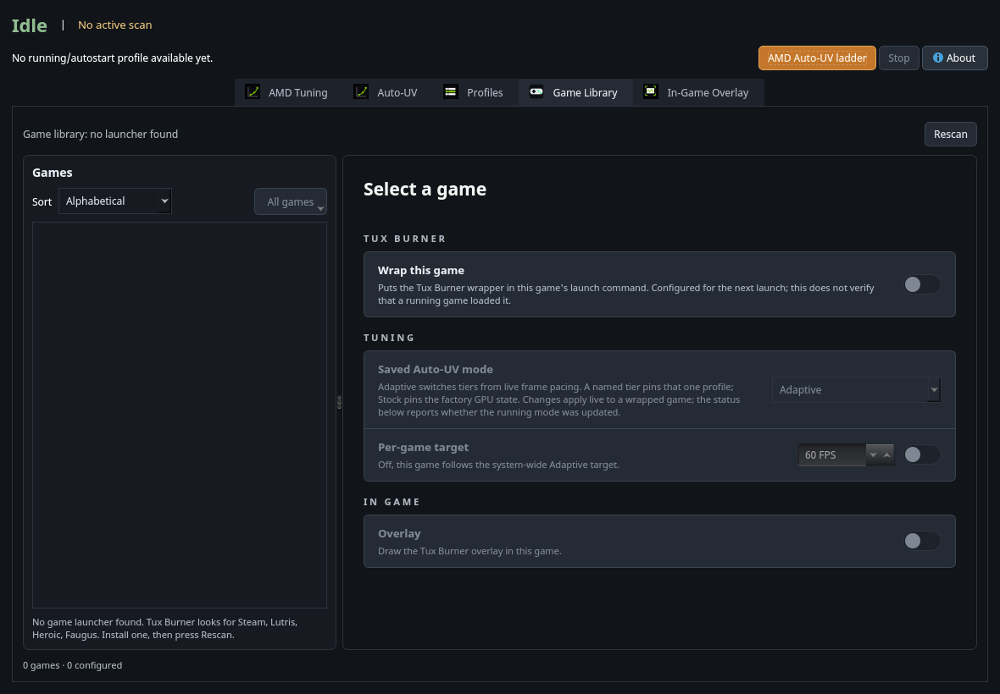
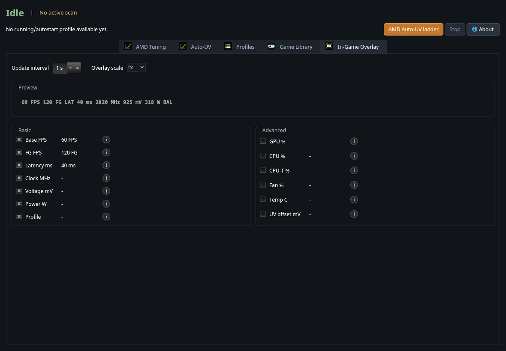
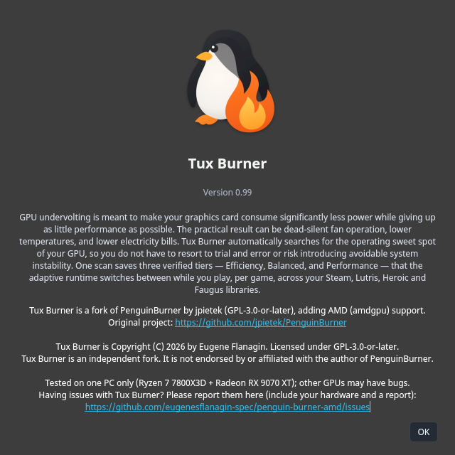

# Tux Burner - User Guide

Version 0.99. Package `tux-burner`. Programs: `tux-burner` (also `tburn`), `tux-burner-cli` (also `tburn-cli`), and the root service `tux-burnerd`.

Tux Burner lets you run your graphics card on **less power with the same speed** (undervolting), or a little faster (overclocking), and saves the settings as profiles. It works on **AMD Radeon** cards through the amdgpu driver (tested on a Radeon RX 9070 XT) and on NVIDIA cards through the original PenguinBurner code.

> **Credit.** Tux Burner is Copyright (C) 2026 by Eugene Flanagin. Licensed under GPL-3.0-or-later.
>
> Tux Burner is a fork of **PenguinBurner** by **jpietek** (<https://github.com/jpietek/PenguinBurner>), GPL-3.0-or-later. The windows, the Auto-UV search, the adaptive per-game runtime, the Game Library, the overlay and the daemon's profile engine are the upstream author's work. This fork adds the AMD backend and renames the program. All upstream licence notices are kept.
>
> **Not affiliated.** Tux Burner is an independent fork. It is not endorsed by or affiliated with the author of PenguinBurner. Please report Tux Burner problems to <https://github.com/eugenesflanagin-spec/tux-burner/issues>, not to upstream.
>
> **Tested on one PC.** Tux Burner's AMD side was tested only on a Ryzen 7 7800X3D with a Radeon RX 9070 XT. Other AMD generations, and the NVIDIA backend in this fork, may have bugs. If you find one, please open an issue with your hardware and the report.

Other pages:

- [CLI-REFERENCE.md](CLI-REFERENCE.md) - every command-line option.
- [GLOSSARY.md](GLOSSARY.md) - every technical word, in plain English.
- [../amd.md](../amd.md) - the AMD design notes (what maps to what in sysfs).

---

## Contents

1. [What it is, in plain words](#1-what-it-is-in-plain-words)
2. [Read this first: safety](#2-read-this-first-safety)
3. [Install](#3-install)
4. [First run](#4-first-run)
5. [The window, page by page](#5-the-window-page-by-page)
6. [The safety floors](#6-the-safety-floors)
7. [LACT and Tux Burner](#7-lact-and-tux-burner)
8. [The Auto-UV ladder](#8-the-auto-uv-ladder)
9. [Profiles](#9-profiles)
10. [Command line](#10-command-line)
11. [Files and settings](#11-files-and-settings)
12. [Moving from PenguinBurner or penguin-burner-amd](#12-moving-from-penguinburner-or-penguin-burner-amd)
13. [Troubleshooting](#13-troubleshooting)
14. [Uninstall](#14-uninstall)
15. [Credits](#15-credits)
16. [Glossary](#16-glossary)

---

## 1. What it is, in plain words

A graphics card is given more voltage than most chips need. **Undervolting** lowers the voltage a little. The card then uses less power, runs cooler and quieter, and (if you did not go too far) is just as fast. Go too far and the card becomes **unstable**: the picture glitches, the driver resets, or the whole PC freezes.

Tux Burner does three jobs:

1. **Shows** what your GPU is doing (voltage offset, clocks, power limit, temperatures, fan).
2. **Changes** those settings, but only when you press a button and confirm, and always inside limits it checks first.
3. **Searches** for a good setting for you (the *Auto-UV ladder*): it lowers the voltage one small step at a time, runs a stress test at each step, and remembers the deepest step that passed.

On an AMD card there is **one** voltage knob (a global offset in millivolts), one core-clock offset, a memory-clock limit, a power cap and a fan curve. On NVIDIA there is a whole voltage/frequency curve, which is why the NVIDIA search is more complicated.

### Who it is for

- Owners of an AMD Radeon (RDNA 3 / RDNA 4 with the amdgpu driver) who want a quieter or cooler card.
- People who already use PenguinBurner on NVIDIA and want to try the fork.

### What it is not

- It is not a benchmark. It is not a replacement for **LACT**; the two can live together (see [LACT and Tux Burner](#7-lact-and-tux-burner)).
- It is not tested on your card. Every GPU is different. Start small.

---

## 2. Read this first: safety

- **Nothing is written to the GPU until you press a button and confirm.** The window opens in a read-only state. *Preview writes (dry run)* shows what would be written and writes nothing.
- A **bad undervolt can freeze the PC** or force a reset. Save your work first. Test on a PC you can reboot.
- **Sustained load.** *Stress test* and the *Auto-UV ladder* run a heavy GPU load for minutes. Do not run them unattended, and watch the temperatures.
- Tux Burner has two **safety floors** for the voltage offset: how deep it is allowed to go. The default is **-150 mV**. The suggested settings it offers never go deeper than **-110 mV**. See [The safety floors](#6-the-safety-floors).
- If LACT is running, **LACT owns the GPU.** Tux Burner will refuse to write unless you say `--override-lact`.
- You run hardware tuning at your own risk. See also `SECURITY.md`.

---

## 3. Install

### Arch Linux, CachyOS and other Arch-based systems

From a release (see the Releases page of the repository):

```bash
sudo pacman -U tux-burner-0.99-1-x86_64.pkg.tar.zst
```

The package `provides` and `conflicts` with `penguin-burner` and `penguin-burner-amd` and `replaces` `penguin-burner-amd`, so it takes over from either. Build it yourself from the source tree:

```bash
git clone https://github.com/eugenesflanagin-spec/tux-burner
cd penguin-burner-amd
git checkout v0.99          # or the branch you want
packaging/build-arch-local.sh
sudo pacman -U /path/shown/at/the/end/tux-burner-0.99-1-x86_64.pkg.tar.zst
```

### Debian, Ubuntu, Fedora, openSUSE

Each release also has a `.deb` and a `.rpm` file, a SHA256SUMS file and this guide as a PDF. These are built by the release workflow; they have been tried less than the Arch package, so please report problems.

```bash
sudo apt install ./tux-burner_0.99-1_amd64.deb     # Debian / Ubuntu
sudo dnf install ./tux-burner-0.99-1.x86_64.rpm    # Fedora
```

Check the download first: `sha256sum -c SHA256SUMS --ignore-missing`.

### What you need besides the package

- The **amdgpu** kernel driver with OverDrive enabled (on most distributions the kernel option `amdgpu.ppfeaturemask=0xffffffff` is needed to see `pp_od_clk_voltage`). Without it Tux Burner can show values but cannot change them.
- For the stress test: an **OpenCL** driver (`rocm-opencl-runtime`, or Mesa's rusticl).
- Optional: **LACT**, **RADV** (`vulkan-radeon`).

### The root service (once)

Changing GPU settings needs root. Tux Burner does that with one small root service, `tux-burnerd`. Install it once, as your normal user:

```bash
tburn-cli --install-systemd-service
```

It asks for your password (pkexec or sudo), installs and starts `tux-burnerd.service`. From then on the window and the command line talk to it over a local socket with no more password prompts. A fresh service applies **nothing** on start: it waits for you.

---

## 4. First run

1. Start **Tux Burner** from the menu (or run `tux-burner`).
2. The window opens on the **AMD Tuning** tab. On the left, *Live status* shows your card: its name, the current VDDGFX offset, SCLK offset, MCLK max, power cap, temperatures, clocks, fan, whether LACT is running, and the two safety floors.



3. In a terminal, check the same thing without the window:

```bash
tburn-cli --amd-status
```

4. Try a **dry run**. On the right, change *VDDGFX offset* to a small value such as -50 mV and press **Preview writes (dry run)**. The text at the bottom lists exactly what would be written, and says "nothing was written".



5. Only when you are happy: **Apply...**, read the confirmation, and confirm.

If the page says "daemon floor unknown (tux-burnerd not reachable)", the root service is not running. Install it as shown above.

---

## 5. The window, page by page

The top bar shows the state (**Idle** / running), a one-line message, the big **AMD Auto-UV ladder** button, **Stop**, and **About**. The tabs are **AMD Tuning**, **Auto-UV**, **Profiles**, **Game Library** and **In-Game Overlay**.

### 5.1 AMD Tuning

**Live status** (read from sysfs every 2 seconds, read-only):

| Row | Meaning |
| --- | --- |
| GPU | Name, PCI address and an id derived from the card. |
| VDDGFX offset | The voltage offset in mV now, and the range the driver allows. Negative means undervolt. |
| SCLK offset | Core clock offset in MHz, and its range. |
| MCLK max | The memory clock ceiling, and the stock value for comparison. |
| Power cap | The power limit in watts, with the minimum, maximum and default the card reports. |
| Temperatures | Edge and junction (hot spot). The fan curve uses the junction. |
| Live | Core clock, memory clock, voltage, power and busy percent right now. |
| Fan | Fan speed and the card's 5-point fan curve. |
| LACT | Whether LACT is running and what it has configured. |
| Safety floors | The app floor and the daemon floor (they must match). |
| Daemon | What `tux-burnerd` reports. |

**Plan** (what you want to set):

| Control | What it does |
| --- | --- |
| VDDGFX offset | Voltage offset in mV. Cannot go below the safety floor. |
| SCLK offset | Core clock offset in MHz. |
| MCLK max (set) | Tick to set an absolute memory clock ceiling. |
| Power cap (set) | Tick to set the power limit in watts. |
| Voltage floor / Allow going below | Unlocks the floor spin box. A warning appears. See [safety floors](#6-the-safety-floors). |
| Durations | Seconds for the Stress test, and seconds per rung for the ladder. |



**Buttons:**

| Button | What it does |
| --- | --- |
| Preview writes (dry run) | Shows the exact writes. Writes nothing. |
| Apply... | After a confirmation, writes the plan through the root service. With LACT running you first choose *Export to LACT*, *Override LACT* or *Cancel*. |
| Save as profile... | Saves the plan as a Tux Burner profile (see [Profiles](#9-profiles)). |
| Export to LACT... | Writes the plan as a LACT configuration block you can paste into LACT's config. |
| Stress test... | Runs the OpenCL stress workload for the chosen seconds, after a confirmation. Heavy load. |
| Auto-UV ladder: preview | The first click previews the rungs; the second asks for confirmation and runs. |
| Load current values | Puts the card's present values back into the editor. |

**Ladder runs (history)**: every ladder run (from the window or the command line) is listed with its settings, floors, result and deepest stable rung. *Show run in the Auto-UV graph* plots it; *Open log* opens the log.

### 5.2 Auto-UV

The upstream NVIDIA Auto-UV page, with the live Clock-vs-Voltage graph. On AMD the graph shows each ladder rung's operating point, coloured by result. The *Start* button is replaced by *AMD Auto-UV ladder*.



### 5.3 Profiles

Saved profiles, including AMD ones: name, tier, the AMD columns (voltage offset, core offset, memory, power), apply, rename, export to LACT, delete, and **Restore Defaults**. On AMD, Restore Defaults offers *Return to LACT's settings* (asks `lactd` to re-apply its profile; no restart) or *Driver stock defaults* (through the root service, with before/after readback).



### 5.4 Game Library

The upstream per-game feature: Steam, Lutris, Heroic and Faugus games, each with its own tuning and overlay switch. Per-game profile switching was written for NVIDIA; on AMD only saved AMD profiles can be applied, and this part has had less testing.



### 5.5 In-Game Overlay

The upstream Vulkan overlay layer (frame rate, GPU numbers, optional latency). It is independent of the AMD tuning code.



### 5.6 About

*About* shows the version, the fork notice, the upstream link and where to report problems.



---

## 6. The safety floors

A **floor** is the deepest VDDGFX offset that will be allowed. There are two, on purpose, so that a bug in one cannot cause a deep undervolt:

| Floor | Where it lives | Default |
| --- | --- | --- |
| **App floor** | The window and `tburn-cli` (plan checks, the ladder). | -150 mV |
| **Daemon floor** | The root service. It refuses any deeper write no matter who asks. | -150 mV |

How they behave:

- The default is **-150 mV**. The card itself may allow -200 mV; Tux Burner stops earlier.
- **Suggested** settings (the three tiers a ladder saves, presets, restore points) never go deeper than **-110 mV**, even though the ladder may *test* down to the floor.
- To go deeper on purpose you must do two things: raise the app floor (`--amd-voltage-floor MV --allow-below-floor`, or tick *Allow going below the safety floor* in the window) **and** lower the daemon floor (`tburn-cli --amd-set-daemon-floor MV --allow-below-floor`, or confirm the window's dialog, which does it for you). Until both match, *Apply* and the ladder are blocked in the window, so no rung is refused halfway and mistaken for a failure.
- The daemon's floor lives in `/etc/tux-burner/amd-vddgfx-floor-mv`. The environment variable `TUX_BURNERD_AMD_VDDGFX_FLOOR_MV` in the service's unit pins it instead (then the file is ignored and the window says so).
- Untick *Allow going below* (or run `--amd-set-daemon-floor default`) to return to -150 mV.

The floors limit the voltage offset only. The SCLK offset, memory clock and power cap are always checked against the ranges the driver reports.

---

## 7. LACT and Tux Burner

**LACT** is a well-known Linux control panel for AMD GPUs. If its service (`lactd`) is running, **LACT owns the GPU's tuning and its fan curve**, and it re-applies its own settings from time to time.

What Tux Burner does about it:

- It detects LACT (the service is active, or its socket exists and a `lact` process runs) and shows the result and LACT's configured values in the window.
- `--amd-apply` and `--amd-auto-uv` **refuse** while LACT runs, unless you add `--override-lact`. In the window, *Apply* then offers *Export to LACT* (the preferred way), *Override LACT* (with a warning) or *Cancel*.
- It never touches the fan curve while LACT runs.
- `--amd-export-lact` writes your plan as a LACT `gpus:` block (voltage_offset, gpu_clock_offsets, max_memory_clock, power_cap and a curve of up to five points) so LACT can carry the setting. Put it in LACT's config yourself.
- **Never restart `lactd` on a live desktop to pick up a change.** Use LACT's own profile switching (`lact cli profile set <name>`) or reboot.

With `--override-lact`, LACT's own settings come back the next time LACT applies them. Restore LACT's values with *Return to LACT's settings* (Profiles > Restore Defaults) or `tburn-cli --amd-restore lact`.

---

## 8. The Auto-UV ladder

On NVIDIA, Auto-UV searches a whole curve. On AMD there is a single voltage offset, so the search is a **ladder**:

1. Start at 0 mV (stock) and go down in steps of 10 mV (`--amd-auto-uv-step`).
2. At each **rung**, apply the offset and run the OpenCL stress workload for 60 seconds (`--amd-auto-uv-rung-seconds`). The workload checks its own results; a wrong answer, a driver error, a hang or a crash fails the rung.
3. Stop at the first failure or at the floor.
4. The deepest rung that passed, **plus a 20 mV margin** (`--amd-auto-uv-margin`), becomes three saved profiles: **Efficiency** (stock power cap), **Balanced** (the cap that was in force when the scan started) and **Performance** (your core offset and the maximum cap). Suggested voltages are never deeper than -110 mV.
5. A marker file is written before each rung. If the PC hard-resets during a rung, the next run reads the marker and treats that offset as **unsafe**.

Use *Auto-UV ladder: preview* (or `--amd-auto-uv --amd-dry-run`) first: it prints the planned range, for example `+0 -> -150 mV`, the number of rungs and the worst-case time. The ladder is heavy sustained load.

In the window, a live **Clock-vs-Voltage** plot shows each rung's measured operating point (voltage from hwmon against core clock), coloured by result, with the current rung highlighted. Each run is saved as `~/.config/TuxBurner/amd-runs/amd-run-*.json`.

Failure types shown in the history: OpenCL mismatch, driver error, hang timeout, process crash, setup error, and "apply refused" (by the floor, the driver range or LACT).

---

## 9. Profiles

A profile is a saved plan. AMD profiles hold the VDDGFX offset, the core offset, the memory ceiling and the power cap.

- **Save:** *Save as profile...* in the window, or `tburn-cli --amd-plan vo=-90 sclk=0 power=304 --amd-save-profile quiet --amd-profile-tier efficiency`.
- **Tiers:** Efficiency, Balanced, Performance. The adaptive runtime (upstream feature) can switch between the tiers while you play; AMD profiles carry no per-point curve, so the drift check that could fight LACT does not apply.
- **Apply:** from the Profiles page. A profile that was saved by hand is marked *unverified*: it has not passed a ladder.
- **Boot profile:** the upstream *Apply on startup* workflow persists a profile in the root service. Leave it off if LACT applies your settings at boot, otherwise the two race.
- **Stock:** *Restore Defaults* (see above) or `tburn-cli --restore-stock`.

---

## 10. Command line

`tburn-cli` and `tux-burner-cli` are the same program. The full list is in [CLI-REFERENCE.md](CLI-REFERENCE.md), `tburn-cli --help` and `man tburn-cli`. The AMD part, in short:

```bash
tburn-cli --version
tburn-cli --amd-status                                        # read-only
tburn-cli --amd-plan vo=-90 sclk=300 mclk=1375 power=374      # preview only
tburn-cli --amd-plan vo=-90 --amd-apply --amd-dry-run         # preview of an apply
tburn-cli --amd-plan vo=-90 --amd-apply                       # write (refused if LACT runs)
tburn-cli --amd-plan vo=-90 --amd-apply --override-lact       # write although LACT runs
tburn-cli --amd-plan vo=-90 --amd-export-lact ~/lact-amd.yaml
tburn-cli --amd-stress 60                                     # OpenCL load; no tuning writes
tburn-cli --amd-auto-uv --amd-dry-run                         # ladder plan
tburn-cli --amd-auto-uv                                       # run the ladder (heavy load)
tburn-cli --amd-restore lact                                  # or: stock
tburn-cli --daemon-status
```

`power=` takes watts or a percent of the default cap (`power=110%`). `fan=` takes up to five `TEMP:PERCENT` points. `zero_rpm=on|off` is also accepted.

---

## 11. Files and settings

| Path | What |
| --- | --- |
| `~/.config/TuxBurner/` | Your profiles, ladder run history (`amd-runs/`), debug logs, settings (`tux_burner.toml`). |
| `/etc/tux-burner/amd-vddgfx-floor-mv` | The daemon's safety floor (root-owned). |
| `/var/lib/tux-burner/` | The daemon's saved state (boot profile, energy counters). |
| `/var/opt/tux-burner/libexec/tux-burnerd` | The installed copy of the daemon binary. |
| `/run/tux-burnerd.sock` | The daemon socket. |
| `/etc/systemd/system/tux-burnerd.service` | The service unit. |

Environment variables: `TUX_BURNER_AMD_VDDGFX_FLOOR_MV` (app floor), `TUX_BURNERD_AMD_VDDGFX_FLOOR_MV` (daemon floor, in the unit), `TUX_BURNER_HOME` (use another home directory).

---

## 12. Moving from PenguinBurner or penguin-burner-amd

Your data is **copied, never moved or deleted**:

- On install, the package copies `/etc/penguin-burner` to `/etc/tux-burner` and `/var/lib/penguin-burner` to `/var/lib/tux-burner` if the new ones do not exist yet.
- On first start, the program copies `~/.config/PenguinBurner` to `~/.config/TuxBurner` (profiles, run history, settings; `penguin_burner.toml` becomes `tux_burner.toml`).
- The daemon also reads the old `/etc/penguin-burner/amd-vddgfx-floor-mv` if the new floor file does not exist.

The **old service** (`penguin-burnerd.service`) is not touched by the package. Switch over yourself, once, so two daemons never run together:

```bash
sudo pacman -U tux-burner-0.99-1-x86_64.pkg.tar.zst
sudo systemctl disable --now penguin-burnerd.service
sudo rm -f /etc/systemd/system/penguin-burnerd.service
sudo tburn-cli --install-systemd-service
tburn-cli --daemon-status
tburn-cli --amd-status
```

Check that `--amd-status` shows your safety floor (and, if you had lowered it, the same value). Once everything looks right you may remove the old directories (`/etc/penguin-burner`, `/var/lib/penguin-burner`, `/var/opt/penguin-burner`, `~/.config/PenguinBurner`).

---

## 13. Troubleshooting

| Problem | What to try |
| --- | --- |
| "daemon floor unknown (tux-burnerd not reachable)" | Install the service: `tburn-cli --install-systemd-service`. Check `systemctl status tux-burnerd`. |
| The values cannot be changed | OverDrive is off. Check that `/sys/class/drm/card*/device/pp_od_clk_voltage` exists. Many distributions need `amdgpu.ppfeaturemask=0xffffffff` on the kernel command line. |
| A write is refused because LACT is running | LACT owns the GPU. Export to LACT, or use `--override-lact` knowing LACT will re-apply its values. |
| Apply or the ladder is greyed out | The app floor and the daemon floor differ. Use the window's *Safety floors* row to sync them. |
| "apply refused by the floor" | The value is deeper than the floor. Raise the floor on purpose (both floors), or pick a shallower value. |
| Stress test says no OpenCL device | Install an OpenCL driver (`rocm-opencl-runtime` or Mesa rusticl) and `ocl-icd`. |
| The screen freezes during a ladder | That offset was too deep. After the reset, run the ladder again: the marker file makes Tux Burner treat that offset as unsafe. Go back to LACT's values or a shallower offset. |
| After switching from PenguinBurner nothing is listed | See [Moving from PenguinBurner](#12-moving-from-penguinburner-or-penguin-burner-amd). Check `~/.config/TuxBurner/`. |
| The Game Library or overlay does nothing | Those parts are upstream NVIDIA-era features and are less tested on AMD. Please report what you see. |

When you report a problem, include `tburn-cli --version`, `tburn-cli --amd-status` and `tburn-cli --daemon-status`. **Remove** your host name, IP addresses and the GPU serial/unique id before posting.

---

## 14. Uninstall

```bash
sudo tburn-cli --uninstall-systemd-service      # stops and removes the service
sudo pacman -R tux-burner                       # or apt remove / dnf remove
```

Your files in `~/.config/TuxBurner/` are kept; delete them if you want. The GPU keeps whatever was last applied until the next reboot or until you restore it (`tburn-cli --amd-restore stock`).

---

## 15. Credits

- **PenguinBurner** by **jpietek**, GPL-3.0-or-later: <https://github.com/jpietek/PenguinBurner>. Based on version 0.8.3.
- **LACT** (<https://github.com/ilya-zlobintsev/LACT>) for the configuration format and the coexistence rules.
- The Linux **amdgpu** driver's OverDrive interface.
- See `CREDITS.md` and `CHANGELOG.md`.

Tux Burner is a fork of PenguinBurner. Changes are Copyright (C) 2026 by Eugene Flanagin. Licensed under GPL-3.0-or-later.

---

## 16. Glossary

See [GLOSSARY.md](GLOSSARY.md). The short version:

- **Undervolt**: lower the voltage so the card uses less power.
- **VDDGFX offset**: the AMD voltage knob, in millivolts; negative is lower.
- **SCLK / MCLK**: core clock / memory clock.
- **Rung**: one step of the ladder.
- **Floor**: the deepest offset allowed.
- **LACT**: a Linux AMD GPU control program.
- **Daemon**: the root service, `tux-burnerd`.
